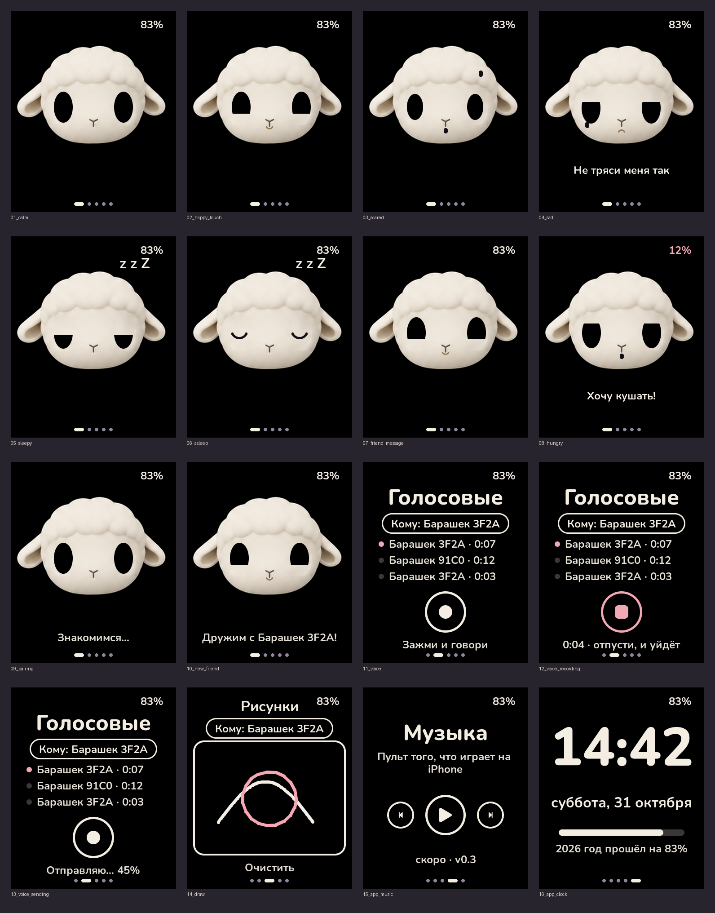

# ILF OS

Прошивка для ILF: карманного барашка на плате Waveshare ESP32-S3-Touch-AMOLED-1.8. Работает только с iPhone.

**Версия 0.2, «Стадо»:**
- знакомство стуком: стукни двух барашков, и они станут друзьями (обмен ключами X25519);
- голосовые другу или всему стаду: зажми кружок, говори, отпусти. Сжатие IMA ADPCM, до ~17 секунд, последние 30 входящих хранятся на самом барашке;
- рисунки: рисуешь пальцем, и штрихи сразу появляются у друга;
- связь ESP-NOW напрямую между барашками, без телефона и интернета, у каждой пары свой ключ шифрования.

**Версия 0.1, «Живой барашек»:** лицо и 7 эмоций, реакции на касание, встряску и наклон, 5 приложений свайпом, часы с «год прошёл на N%», умный сон экрана.



## Как устроено

```
main/              склейка: задачи FreeRTOS, умный сон; ilf_net.c — ESP-NOW и ключи, ilf_voice.c — запись, проигрывание, хранение
components/
  ilf_soul/        «душа» на чистом C: эмоции, моргание, взгляд, засыпание; плюс часы и % года
  ilf_ui/          экран на LVGL 9: лицо барашка и приложения (Питомец, Голосовые, Рисунки, Музыка, Часы)
  ilf_herd/        стадо на чистом C: знакомство, друзья, доставка сообщений, рисунки, сжатие голоса
  ilf_hal/         железо: I2C, экран QSPI, тач, гироскоп QMI8658, часы PCF85063, питание AXP2101, кнопка, звук ES8311
  lvgl/            LVGL v9.2.2 (git submodule)
tests/             тесты души и часов, запускаются на ПК
sim/               симулятор: тот же код души и экрана рисует скриншоты на ПК
```

Душа ничего не знает про железо. Она получает события (`ILF_EV_TOUCH`, `ILF_EV_SHAKE`, …) и отдаёт описание лица (`ilf_face_t`), а экран его рисует. Поэтому характер барашка можно отлаживать на компьютере, без платы.

Плата бывает двух ревизий, прошивка определяет её сама:
- **V1:** экран SH8601, тач FT3168;
- **V2:** экран CO5300, тач CST820.

## Сборка и прошивка

Нужен ESP-IDF 5.3 или новее.

```bash
git clone --recursive https://github.com/<owner>/ilf-os.git
cd ilf-os
idf.py set-target esp32s3
idf.py build
idf.py -p /dev/cu.usbmodem* flash monitor     # на Mac; на Windows — COM3 и т.п.
```

Если плата не прошивается: зажми BOOT, нажми и отпусти RESET, отпусти BOOT, попробуй снова.

## Тесты и симулятор (на компьютере, без платы)

```bash
cmake -S tests -B build/tests && cmake --build build/tests && ./build/tests/ilf_tests && ./build/tests/ilf_herd_tests
./sim/run.sh          # скриншоты появятся в sim/out/
```

## Что проверить на живой плате (после 12 ноября)

1. Экран включается, цвета правильные (не инвертированы), картинка не сдвинута.
2. Тач попадает туда, куда нажал.
3. Направление взгляда при наклоне. Оси гироскопа подбираются в `main/main.c`, функция `sensors_task`.
4. Порог встряски: чтобы барашек пугался от встряски, но не от ходьбы.
5. Процент батареи с AXP2101.
6. Звук: слышно ли динамик (пин усилителя `ILF_PA_EN` в `ilf_board.h`), громкость и чувствительность микрофона (`ilf_audio.c`).
7. Стадо (нужны два барашка): знакомятся ли от стука, доходят ли голосовые и рисунки, на каком расстоянии.
8. Расход батареи: радио ESP-NOW сейчас слушает постоянно, это заметно сажает АКБ 140 мАч.

## Дальше

- **v0.3:** голосовые через Wi-Fi и сервер, пульт музыки iPhone (AMS).
- **v0.4:**
  - уведомления iPhone (ANCS);
  - время и часовой пояс с iPhone (CTS);
  - обновления по воздуху.

Дизайн интерфейса: макет `assets/ui/ilf_ui_mockup_v2.png`. Голова барашка вырезается из него скриптом `tools/gen_head.py` (глаза закрашиваются, носик остаётся), а глаза, веки, рты, слёзы и «zzz» прошивка рисует поверх сама, поэтому барашек моргает и смотрит по сторонам. Глаза — `tools/gen_eye.py`.

Шрифт Nunito (Bold и ExtraBold): SIL Open Font License, `assets/fonts/`.
